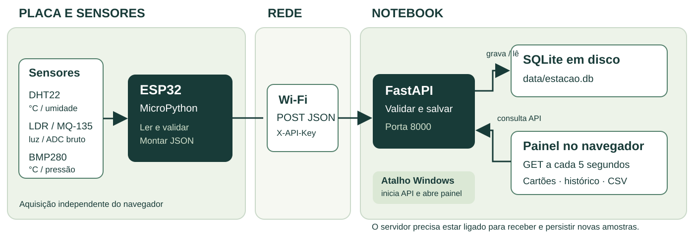
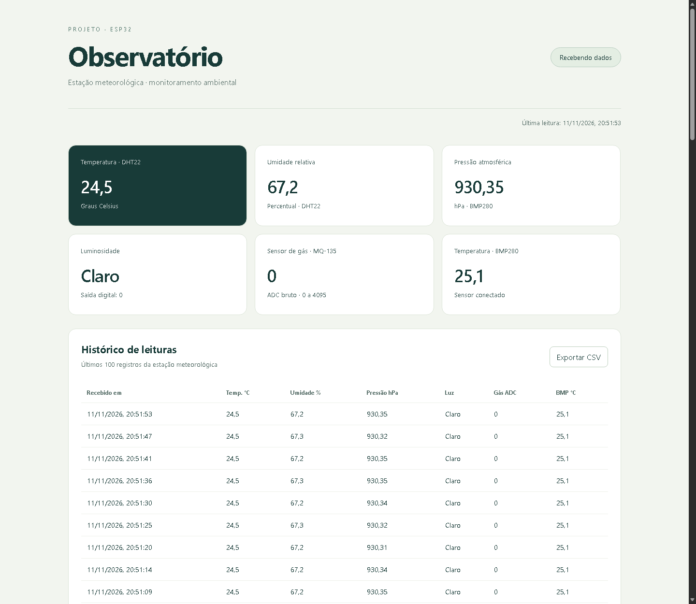

# Estação Meteorológica com ESP32

## Relatório completo de desenvolvimento, diagnóstico e entrega

**Projeto acadêmico — versão consolidada em 11 de novembro de 2026.**

**Pasta ativa:** `C:\Users\Windows\computer-science\estacao-meteorologica`.

**Corte dos dados:** registros até o ID **4564**, consultados em **11/11/2026, às 20:16:07**, horário de Brasília, UTC−3. O último registro desse corte foi recebido às 20:16:00. A estação pode continuar recebendo dados depois desse ponto; o conteúdo deste documento é uma fotografia histórica.

**Escopo:** evolução do arquivo original executado no Thonny até a aplicação atual, com firmware modular, API FastAPI, banco SQLite, painel web, diagnóstico dos sensores, recuperação de leituras do BMP280, atalho Windows, identidade visual e organização dos arquivos para o grupo.

## 1. Apresentação e resultado alcançado

O projeto começou com um programa principal para ESP32 e a necessidade de organizar o trabalho para a faculdade. Além de separar cada sensor em seu próprio arquivo, o grupo precisava visualizar as medidas em uma interface, disponibilizar uma API com FastAPI e preservar os dados em banco. O trabalho passou a envolver tanto o software do computador quanto o programa da placa e a investigação da montagem física.

A solução final distribui essas responsabilidades. O ESP32 executa MicroPython, lê os sensores e envia JSON pela rede. O computador executa FastAPI e registra os dados em SQLite. O navegador consulta a API e apresenta as últimas medidas e o histórico. O VS Code é o ambiente de edição; ele não substitui o firmware da placa nem precisa permanecer aberto para o servidor funcionar.

No corte deste relatório, o banco continha **4.564 registros**, todos associados a `esp32-01`. Em **1.188** deles havia medição BMP validada; em **3.376**, os campos BMP estavam nulos. Os demais tipos de sensor tinham seus campos preenchidos nos registros recebidos. Isso descreve a disponibilidade dos dados armazenados, não uma certificação da exatidão física dos instrumentos.

A partir do registro **3443**, o banco contém **1.122 registros recebidos com BMP validado**, sem novo registro BMP nulo até o corte. Entretanto, houve períodos sem recepção. A maior lacuna foi superior a três horas. Por isso, a afirmação correta é que todas as amostras recebidas nessa fase tinham BMP válido, e não que a estação coletou ininterruptamente durante todo o período.

A implementação atual possui um atalho **Estação Meteorológica** na área de trabalho. Ele reconhece uma API da estação já ativa, ou inicia o servidor em um console quando necessário, e abre o painel. O ícone final é uma rosa dos ventos de oito pontas, em branco e verde petróleo, sem letras e com fundo transparente.

## 2. Fontes, método e limites do histórico

Este documento foi elaborado a partir dos arquivos públicos do projeto, do registro de alterações, dos relatórios técnicos anteriores, dos logs estruturados dos testes, de consultas somente leitura ao banco e das ações registradas durante a sessão. Os dados numéricos de encerramento foram exportados com um limite de ID explícito, para permitir reproduzir os resultados sem misturá-los com novas medidas.

Nem todas as mensagens antigas possuem data e hora próprias disponíveis. A fase inicial é apresentada pela sequência das solicitações, sem inventar uma data de início. Os marcos de 04/11 e 10/11 seguem o `CHANGELOG.md`. Parte da revisão de 04/11 foi realizada em outro computador e sem o ESP32; ela não deve ser descrita como um ensaio físico naquela máquina.

Três módulos vendidos como sensores da família “280” foram discutidos e trocados ao longo da investigação. Em vários momentos, sua identificação dependia do que o usuário informava. O banco não registra uma etiqueta física, número de série do módulo, calibração ou RAW de cada medida. As atribuições históricas que ficaram incertas permanecem explicitamente incertas neste relatório.

Não foram realizadas medições com multímetro, osciloscópio ou analisador lógico durante os testes documentados. Um nível digital de GPIO ou uma resposta I²C não substitui medir tensão e forma de onda. Também não houve comparação com barômetro ou termômetro de referência que certificasse a precisão metrológica.

Credenciais reais, conteúdo de `.env`, configuração privada da placa, imagens integrais da flash e backups privados não fazem parte deste relatório compartilhável. Exemplos de configuração usam nomes genéricos. Os anexos fornecem dados de sensores e evidências técnicas selecionadas.

## 3. Situação inicial e objetivos da reorganização

O arquivo citado originalmente era `main.py.py`, usado no Thonny. O programa reunia acesso aos sensores, conexão de rede, rotinas auxiliares e execução contínua. Essa concentração dificultava localizar a origem de uma falha, testar um componente isoladamente e dividir responsabilidades entre os integrantes do grupo.

Uma análise restrita da estrutura do original confirmou imports de `machine`, `network`, `socket`, `time`, `ujson`, `dht` e `struct`, uma classe `BMP280` e a função `conectar_bmp`. A pinagem original identificada era LDR no GPIO21, DHT22 no GPIO4, MQ-135 no GPIO34 e BMP com SCL18/SDA19. A configuração atual do BMP e do LDR é diferente.

Os objetivos definidos foram:

1. Separar os sensores em arquivos próprios, mantendo um `main.py` coordenador.
2. Migrar a rotina de desenvolvimento para o VS Code sem confundir MicroPython e Python do computador.
3. Criar uma API FastAPI para receber e consultar medidas.
4. Persistir o histórico em banco de dados.
5. Criar um frontend para acompanhar os sensores e exportar os registros.
6. Produzir documentação que permitisse ao grupo executar, compreender e manter o sistema.

Durante o trabalho, foram acrescentados objetivos operacionais: investigar o BMP280, preservar backups antes de testes de firmware, facilitar a inicialização por atalho, personalizar a aparência e preparar entregas compactadas para WhatsApp.

## 4. Linha do tempo consolidada

| Fase | Trabalho realizado | Evidência ou resultado |
| --- | --- | --- |
| Início, data exata não registrada | Recebimento do programa do Thonny e definição dos requisitos | Arquivo principal e solicitações de modularização, API, frontend e banco |
| Estruturação | Separação entre firmware, backend, frontend e scripts | Organização atual de pastas e funções |
| 04/11, conforme histórico | Revisão de autenticação, `.env`, modelos, mensagens e ambiente | Correções documentadas; parte feita em outro notebook, sem ensaio físico |
| 10/11, conforme histórico | Diagnóstico BMP, validação de dados inválidos e ajustes de pinagem | LDR18, DHT4, MQ34 e BMP21/22 passaram a ser a referência final |
| 10/11, 23h56–23h57 | Primeira janela BMP preenchida encontrada no banco atual | Seis registros, IDs 1828–1833, sem identificação física suficiente do módulo |
| 11/11, manhã e início da tarde | Trocas de módulos, testes de comunicação e novas janelas plausíveis | Períodos curtos com dados intercalados com BMP nulo |
| 11/11, 12h56 | Teste independente Arduino/Adafruit após backups | 179 amostras com ADC térmico zero; MicroPython restaurado depois |
| 11/11, 13h37 e 14h16 | Monitores MicroPython com RAW e calibração | 18 tentativas em cada janela, nenhuma BMP válida |
| 11/11, 14h20min17s | Retorno das medidas no programa normal | ID 3443, antes do monitor temporário que começou por volta de 14h20min31s |
| 11/11, a partir de 14h20min31s | Captura detalhada da montagem que estava medindo | 18/18 válidas, com RAW e coeficientes contemporâneos |
| 11/11, até 14h40 | Preservação da primeira referência extensa de recuperação | 217 registros válidos e evidências públicas |
| Depois da recuperação | Atalho, testes de inicialização e identidade visual | Console automático, reconhecimento de API, navegador e ícones |
| Organização final | Migração para `computer-science` | Ambiente reconstruído, dados preservados e atalho atualizado |
| Limpeza da área de trabalho | Exclusão das duas pastas antigas autorizadas | Backup privado completo e envio das pastas antigas à Lixeira |
| Estado final deste documento | Consolidação até o ID 4564 | API respondendo e histórico preservado; ícone de rosa dos ventos |

As datas de alteração de arquivos e a ordem das entradas do changelog não substituem a cronologia das medições. Os horários e IDs apresentados nas tabelas de dados são sustentados pelo banco ou pelos logs correspondentes.

## 5. Arquitetura atual e separação dos ambientes



O caminho principal é: sensores → ESP32 → Wi-Fi → FastAPI → SQLite → painel. O navegador não lê diretamente os pinos e não precisa estar aberto para o ESP32 enviar. O servidor, por sua vez, precisa estar disponível para aceitar e salvar o POST.

| Ambiente | Responsabilidade | Exemplos de arquivos |
| --- | --- | --- |
| ESP32 / MicroPython | Ler pinos e sensores, compensar BMP, conectar e enviar | `firmware/main.py`, `firmware/sensors/`, `wifi.py`, `api_client.py` |
| Notebook / Python | Validar HTTP, autenticar gravações e persistir | `backend/main.py`, `schemas.py`, `database.py` |
| Navegador | Consultar, formatar, exibir e exportar | `frontend/index.html`, `app.js`, `style.css` |
| Windows / operação | Abrir servidor e navegador e criar atalho | `scripts/iniciar_estacao.py`, `criar_atalho.ps1` |
| Desenvolvimento e manutenção | Testes, diagnóstico, backup e entrega | `tests/`, `scripts/`, `diagnosticos/` |

O firmware não deve ser executado com o Python comum do notebook, porque depende de módulos como `machine` e `dht`. O backend não deve ser enviado à placa. O mesmo editor pode trabalhar nos dois conjuntos de arquivos, mas eles são executados em ambientes diferentes.

### Ambiente de referência

| Componente | Versão ou condição registrada |
| --- | --- |
| Python do notebook | 3.14.2 |
| MicroPython da placa | 1.29.0, observado nos testes da sessão; não relido pela serial para gerar o relatório |
| FastAPI / Uvicorn | 0.136.0 / 0.41.0 |
| python-dotenv | 1.2.2 |
| pytest / mpremote | 9.0.3 / 1.29.0 |
| SQLite da biblioteca do notebook | 3.50.4 |
| Execução principal | Rede local, porta 8000 e banco em disco |

## 6. Modularização do firmware

O `main.py` atual instancia os quatro tipos de sensor, chama `ler()` de cada um e reúne os resultados em um dicionário. Os drivers retornam os campos de sua responsabilidade. Essa interface simples permite manter o laço principal legível e substituir ou testar um driver sem reescrever a API.

```text
main()
  criar os sensores
  repetir:
    criar payload com estacao_id
    ler cada sensor e reunir os campos
    conectar/reutilizar Wi-Fi
    enviar JSON à API
    aguardar o intervalo configurado
```

Há tratamento de exceção por sensor e no envio. Uma falha do BMP prevista pelo driver retorna seus campos nulos, permitindo enviar as outras medidas. Isso não significa que todo erro arbitrário possa ser ignorado: se uma exceção inesperada impedir campos obrigatórios como LDR/estado/BMP, a API pode rejeitar o payload incompleto com 422.

O intervalo é `max(3, INTERVALO_SEGUNDOS)` depois de ler e enviar. Portanto, a configuração de cinco segundos não produz necessariamente recepções em intervalos exatos de cinco segundos. Aquisição, conexão, transmissão e eventuais novas tentativas aumentam o tempo entre registros.

A conexão Wi-Fi foi separada em `conectar()`. O cliente HTTP usa socket, JSON e cabeçalho de autenticação, aceita status 201 e fecha a conexão em `finally`. O ESP32 não passou a depender de um serviço externo para converter a leitura do BMP: a compensação continua no driver da placa.

## 7. Sensores, pinagem e significado dos dados

| Sensor | Pino final | Campo | Unidade ou interpretação |
| --- | --- | --- | --- |
| DHT22 | GPIO4 | `temperatura`, `umidade` | °C e umidade relativa % |
| LDR digital | GPIO18 | `luz`, `estado` | 0 = Claro; 1 = Escuro |
| MQ-135 | GPIO34 | `gas` | Contagem ADC de 0 a 4095 |
| BMP280 | SDA21 / SCL22 | `temperatura_bmp`, `pressao` | Temperatura interna em °C e pressão em hPa |

São quatro tipos de sensor. A referência a “três sensores” em parte da conversa dizia respeito aos três módulos BMP examinados, não ao total de tipos presentes na estação.

O LDR usado é digital e não entrega iluminância em lux. O MQ-135 é lido como ADC bruto; não houve calibração para ppm, índice de qualidade do ar ou identificação de um gás específico. Valores como 200, 400 ou 1200 não devem ser apresentados como concentração calibrada.

O DHT22 respeita intervalo mínimo de 2,5 segundos no driver e retorna nulos quando sua aquisição falha. Sua temperatura representa outra medição, separada da temperatura interna do BMP. Uma pequena diferença entre os dois valores, isoladamente, não demonstra defeito nem autoriza escolher um offset.

### Ligação final de referência do BMP de seis terminais

| Terminal do módulo | Ligação |
| --- | --- |
| VCC | 3V3 do ESP32 |
| GND | GND comum |
| SDA / SDI | GPIO21 / D21 |
| SCL / SCK | GPIO22 / D22 |
| CSB / CS | 3V3, na montagem I²C informada |
| SDO | GND, selecionando endereço 0x76 |

As ligações devem seguir as inscrições dos terminais. O pente soldado por outra face muda a aparência e pode inverter visualmente a ordem dos fios. Cores dos jumpers citadas durante trocas não são uma identificação permanente da função elétrica.

O usuário informou instalar dois resistores de 4,7 kΩ, com faixas amarelo, violeta, vermelho e dourado. Não houve medição instrumental de sua posição final ou resistência equivalente. Os pull-ups previstos ficam entre sinal e 3V3; não são resistores em série. Antes de acrescentar outros, deve-se verificar os já existentes no módulo e na montagem.

## 8. API FastAPI e autenticação

A API tornou explícita a separação entre envio e visualização. O POST valida os dados, exige a chave e salva a leitura. Os GET consultam o banco. A documentação interativa em `/docs` ajuda a verificar os formatos sem depender do código do frontend.

| Método e caminho | Função |
| --- | --- |
| `GET /` | Painel HTML |
| `GET /static/...` | JavaScript, CSS e favicon |
| `GET /api/saude` | Disponibilidade básica da API |
| `POST /api/leituras` | Receber e persistir uma leitura, com `X-API-Key` |
| `GET /api/leituras` | Histórico com estação, limite e cursor opcionais |
| `GET /api/leituras/ultima` | Último registro, ou 404 quando não há dados |
| `GET /docs` e `/openapi.json` | Documentação e contrato gerados pelo FastAPI |

O parâmetro `limite` aceita de 1 a 1000, com padrão 100. `antes_id` permite buscar registros anteriores. O retorno é ordenado por ID decrescente, de forma que o painel usa a primeira linha como última leitura. O backend continua admitindo filtros, embora o frontend final mostre apenas `esp32-01`.

O arquivo `.env` do computador define a chave do servidor. O `config.py` privado da placa deve ter a mesma chave. A API lê `.env` com `override=True`, evitando que uma variável esquecida no terminal prevaleça sobre esse arquivo. Uma alteração de chave exige encerrar e iniciar o servidor para que a configuração carregada seja atualizada.

| Resposta | Interpretação no projeto |
| --- | --- |
| 201 | Leitura aceita e salva |
| 401 | Chave recebida incorreta ou ausente |
| 503 | Servidor sem chave configurada |
| 422 | Corpo inválido, incoerente ou sem campo obrigatório |
| 404 | Rota/registro não encontrado, conforme a consulta |
| Timeout/erro de conexão | Servidor, endereço, rede, porta ou acesso precisam ser verificados |

A chave é comparada com `secrets.compare_digest`. Uma impressão digital de seis caracteres de SHA-256 foi usada para comparar configurações nos logs sem revelar a chave. Ela é um auxílio de diagnóstico, não um segundo mecanismo de autenticação nem prova de identidade forte.

O projeto é uma aplicação local. O POST é protegido por chave, mas as consultas e o painel não possuem autenticação de usuário. Não foram implementados HTTPS, contas individuais ou publicação segura na internet. Essas funções não devem ser pressupostas apenas porque a API está funcionando na rede do laboratório.

## 9. Persistência SQLite e contrato dos campos

O banco padrão fica em `data/estacao.db`, relativo à raiz do projeto. Ele é criado na inicialização e continua disponível depois de fechar o navegador ou reiniciar a API. Não é necessário instalar um servidor de banco separado.

| Campo | Regra atual |
| --- | --- |
| `id` | Inteiro autoincremental, acrescentado pelo servidor |
| `recebido_em` | Horário UTC de recepção, acrescentado pelo servidor |
| `estacao_id` | Identificador de 1–64 caracteres; painel usa `esp32-01` |
| `luz`, `estado` | 0/1 e Claro/Escuro, com coerência entre os dois |
| `temperatura` | Número ou nulo, entre −40 e 80 °C |
| `umidade` | Número ou nulo, entre 0 e 100% |
| `gas` | Inteiro ou nulo, entre 0 e 4095 |
| `pressao` | Número ou nulo, entre 300 e 1100 hPa |
| `temperatura_bmp` | Número ou nulo, entre −40 e 85 °C |
| `bmp_conectado` | Booleano coerente com os dois campos BMP |

Campos desconhecidos e números NaN/infinito são recusados. A API exige os dois valores BMP quando o booleano é verdadeiro e exige ambos nulos quando é falso. O firmware produz temperatura e umidade do DHT como par; o contrato da API não impõe por si só essa mesma regra de paridade ao DHT.

As inserções usam parâmetros SQL, e há índice para estação/ID. O timestamp registrado é o instante de recepção no computador, não um relógio de aquisição emitido pela placa. O navegador o converte para o fuso local.

Um banco persistente preserva o que foi aceito; ele não cria medidas durante um período de indisponibilidade. O firmware atual não possui fila offline para reenviar depois uma amostra perdida. Também não há política de retenção automática ou deduplicação de uma tentativa cujo resultado HTTP tenha ficado ambíguo.

## 10. Painel e evolução da experiência de uso

O frontend recebeu o nome **Observatório**, com paleta verde petróleo, cartões claros e organização responsiva. Seus seis cartões exibem temperatura DHT, umidade, pressão, luminosidade, ADC do MQ-135 e temperatura BMP. O histórico reúne os últimos 100 registros carregados e pode ser exportado em CSV.

A primeira versão tinha campo de seleção de estação e botão Atualizar. O usuário observou que só havia um ESP32 no projeto. Esses controles foram removidos. A versão final consulta diretamente `esp32-01`, carrega ao abrir e se atualiza a cada cinco segundos. O horário de recepção permanece visível.

O JavaScript impede consultas sobrepostas, usa timeout de oito segundos e alerta quando a última recepção tem mais de 30 segundos. Se a API fica indisponível, o texto avisa que os dados podem estar desatualizados. Mostrar uma medida antiga não comprova que a coleta continua ativa; é preciso observar o horário e o avanço dos IDs.

O CSV usa separador ponto e vírgula, BOM UTF-8, escape de aspas e quebras CRLF. Ele contém o conjunto carregado no painel, não o banco inteiro, e não inclui os bytes brutos do BMP. O script de simulação usa `estacao_id=simulador`, mantido separado das medidas reais e consultável pela API; ele não aparece automaticamente no painel fixo.

O ícone passou por alternativas: janela ilustrada de estação, símbolo de navegador inspirado no Edge, versão branca e, por fim, **rosa dos ventos de oito pontas**. O último desenho é branco e verde petróleo `#183B38`, com fundo transparente e sem letras. O vetor SVG, a prévia PNG e o ICO ficam em `assets/`; o mesmo vetor é usado como favicon.



A captura de interface foi feita na elaboração deste relatório. Os valores nela podem ser posteriores ao corte estatístico ID 4564; sua função é documentar a apresentação e não substituir a exportação dos dados.

## 11. Problemas de execução encontrados e correções

| Problema observado | Investigação e tratamento |
| --- | --- |
| Uso de `0.0.0.0:8000` no navegador | Diferenciar endereço de escuta de endereço de acesso; usar `localhost:8000` no notebook |
| Ambiente Python incorreto | Usar o executável da `.venv` ou selecionar o interpretador correto no VS Code |
| `No module named dotenv` | Dependência `python-dotenv` precisa estar no mesmo ambiente que executa Uvicorn |
| `.venv` copiada de outra pasta/computador | Recriar o ambiente no destino em vez de depender de caminhos antigos dos executáveis |
| Erros de socket/porta no Windows | Conferir quem atende na porta e não iniciar servidores duplicados ou encerrar processos arbitrários |
| POST 401 | Conferir correspondência da chave e reiniciar o servidor após alterar `.env` |
| Painel sem medidas | Separar frontend, API, persistência, rede e envio da placa antes de culpar o HTML |
| Hotspot reconfigurado | Conferir mesma rede e IP do notebook na `API_URL` do ESP32 |
| Texto com acentos incorretos | Corrigir a codificação dos documentos e mensagens para UTF-8 |
| BMP inválido bloqueando dados | Retornar nulos no driver e manter o payload coerente para os demais sensores |

Os logs tinham vários GET com 200 e um POST com 401. Esses resultados não se contradizem: consultar o histórico e autenticar uma gravação são operações diferentes. Um painel acessível não garante que a placa conseguiu salvar a próxima medida.

Inicializar o servidor antes de substituir uma chave de exemplo não foi tratado como corrupção do banco ou dano à placa. A investigação se concentrou na configuração efetivamente carregada, no alcance da rede e na correspondência das chaves.

## 12. Investigação física e digital do BMP280

O BMP280 foi a parte mais extensa do diagnóstico. O usuário informou que um módulo funcionava no ESP32 do professor, mas o código dele não estava disponível. Esse relato foi uma pista para comparação, não uma comprovação independente da condição atual do sensor na nossa montagem.

Foram examinadas ligações com diferentes pares de pinos, incluindo as etapas com GPIO18/19, a troca de SCL19 para SCL22 e a configuração definitiva SDA21/SCL22. O LDR foi retirado do GPIO21 para o GPIO18. Uma dúvida inicial sobre o fio do DHT22 foi esclarecida: o fio movido era do LDR, e o DHT permaneceu no GPIO4.

O usuário confirmou que apenas um BMP estava ligado em determinada etapa; os outros sensores podiam continuar montados. Foram feitos testes de scan, endereço 0x76/0x77, ID, calibração, status, leitura em bloco e por partes, modos normal/forçado, sobreamostragem, frequências e resets. Testes de comunicação não devem ser descritos como se o software pudesse enxergar fisicamente a solda ou identificar a cor do jumper.

No segundo módulo, houve momentos sem ACK e com SCL lido em zero. O isolamento do fio SCL no lado do módulo permitiu observar o GPIO alto, mas reconectar e desligar/religar ocorreram próximos. Isso não isolou uma causa física única. Nível baixo não foi considerado prova suficiente de curto ou sensor queimado.

No módulo identificado como HW-611, era possível obter ID, calibração e contagens de pressão variáveis enquanto os bytes de temperatura permaneciam zerados. Esse comportamento é diferente de nunca encontrar o endereço. Também não é resolvido apenas afirmando que “o sensor precisa calibrar”.

### O problema da temperatura bruta zero

O driver lê seis bytes a partir de F7. Os três primeiros formam ADC de pressão e os três seguintes, ADC térmico, ambos de 20 bits. `00 00 00` não significa uma temperatura ambiente de 0 °C.

Com a referência de calibração anterior, aplicar a fórmula ao ADC_T=0 produzia aproximadamente **−132,73 °C**. Esse número era consequência matemática de uma entrada térmica inválida para o uso pretendido, não um ambiente realmente nessa temperatura. A pressão calculada com essa compensação também não foi publicada como uma medida validada.

O driver passou a rejeitar ADC zero, `0x80000` e `0xFFFFF`, além de resultados compensados fora da faixa. O valor `0x80000` é uma sentinela distinta; não deve ser confundido com `0x00000`. O objetivo foi preservar a coerência dos dados, sem transformar erro em um valor visualmente agradável.

Não se somou um offset arbitrário à temperatura, não se escreveu uma temperatura escolhida nos dados brutos e não se usou o DHT22 para substituir o valor interno na compensação. A documentação técnica associa a pressão ao resultado térmico interno e aos coeficientes do componente. Os registradores de dados não são campos de calibração livre para editar. [Bosch, compensação e mapa de registros](https://www.bosch-sensortec.com/media/boschsensortec/downloads/datasheets/bst-bmp280-ds001.pdf).

## 13. Teste independente Arduino e restauração

Foi discutida a possibilidade de verificar a biblioteca Arduino/Adafruit. A execução em C++ substituiria temporariamente o MicroPython; não seriam os dois programas rodando simultaneamente no mesmo espaço de firmware. O usuário autorizou prosseguir desde que o sistema fosse preservado.

Antes da gravação, foram salvos fontes/configurações e snapshot consistente do banco. Duas leituras integrais da flash de **4 MiB** foram obtidas a 115200 baud e comparadas. Ambas apresentaram o mesmo SHA-256:

```text
C52BE2D30FD954D265346E2C6A186551EDBC2BBAB2F9421B41561B9F62921EED
```

O backup da fase continha 41 arquivos do projeto, snapshot com 2.768 registros e 14 arquivos do sistema de arquivos da placa conferidos. Essas são contagens daquele ponto, não o inventário final de hoje. As imagens da flash são privadas e não acompanham o arquivo compartilhável.

| Item do teste Arduino | Valor registrado |
| --- | --- |
| Arduino CLI | 1.6.0 |
| Core Arduino-ESP32 | 2.0.17 |
| Adafruit BMP280 Library | 3.0.0 |
| I²C | SDA21/SCL22, 100 kHz |
| Perfil | Normal, temperatura ×16, pressão ×16, filtro desligado |
| Início | 11/11, 12:56:48 UTC−3 |
| Duração / amostras | 180 s / 179 amostras |
| ADC térmico zero | 179 de 179 |
| Medições plausíveis | 0 |

O sketch não usava Wi-Fi nem enviava à API. Portanto, os valores **23,8 °C e 936,22 hPa** encontrados anteriormente no banco **não vieram desse teste Arduino**. Eram registros MicroPython anteriores.

O resultado independente reduziu a força da hipótese de erro exclusivo da fórmula Python, mas não identificou a causa física. As próprias consultas diagnósticas não tiveram erro; isso não certifica todas as operações internas da biblioteca, nem permite afirmar que o módulo estava eletricamente perfeito.

Após o ensaio, a flash original foi regravada e verificada integralmente. Os 14 arquivos da placa coincidiram com o estado salvo e o MicroPython voltou a iniciar. Não houve gravação de eFuses nem erase-all. O banco do notebook não foi revertido para um snapshot antigo; as novas leituras continuaram sendo acrescentadas.

## 14. Recuperação do BMP: janelas, evidências e incerteza causal

O banco contém os seguintes períodos válidos antes da fase de recuperação a partir de 3443:

| Data e horário local | IDs | Registros | Temperatura BMP | Pressão hPa |
| --- | --- | ---: | --- | --- |
| 10/11, 23:56:49–23:57:17 | 1828–1833 | 6 | 27,8–29,6 °C | 937,42–937,49 |
| 11/11, 11:46:43–11:47:52 | 2334–2346 | 13 | 25,3–28,8 °C | 936,82–936,89 |
| 11/11, 12:06:15–12:06:21 | 2511–2512 | 2 | 24,3–24,5 °C | 936,48–936,53 |
| 11/11, 12:06:54 | 2518 | 1 | 24,4 °C | 936,50 |
| 11/11, 12:15:55–12:19:52 | 2617–2660 | 44 | 23,8–24,0 °C | 936,21–936,30 |

Esses 66 registros são reais no histórico, mas não identificam eletronicamente qual módulo físico os originou. Em uma janela o usuário confirmou o segundo; em outra informou o professor e depois levantou a possibilidade de confusão durante a troca. O relatório não transforma essa dúvida em certeza.

Dois monitores posteriores, às 13h37 e 14h16, registraram 18 tentativas cada com ADC_T=0. Na segunda janela o HW-611 foi explicitamente confirmado. Os outros sensores continuaram sendo enviados: **18 envios aceitos não significam 18 medições BMP válidas**, pois o payload podia ter BMP nulo.

Depois da orientação de troca para o segundo módulo, o usuário respondeu “pode ir”. A identificação desse novo teste é contextual. O banco já recebeu BMP válido no **ID 3443, às 14:20:17**, e nos dois registros seguintes. O monitor começou depois, por volta de **14:20:31**. Assim, o retorno das medidas **não foi causado comprovadamente pelo monitor**, pelo Arduino ou por uma nova biblioteca.

O monitor válido gerou **18/18 medições BMP aceitas**, uma inicialização e 18 envios aceitos. Um proxy capturou o mesmo bloco bruto consumido pela chamada que calculou a medida, e a calibração recém-lida conferiu com o cache.

| Evidência da primeira amostra | Valor |
| --- | --- |
| RAW de seis bytes | `6028507f2480` |
| ADC de pressão | 393861 |
| ADC de temperatura | 520776 |
| Temperatura recalculada independentemente | 23,58981788696 °C |
| Pressão recalculada independentemente | 935,01291463091 hPa |
| Valores arredondados enviados | 23,6 °C / 935,01 hPa |

Bloco de calibração da janela válida:

```text
266d276918fc7d9520d6d00b9f130e01f9ff8c3cf8c67017
```

Referência anterior do HW-611:

```text
d46a7a633200b9946ed6d00bd513f9fff9ff8c3cf8c67017
```

A diferença ajuda a comparar estados, mas não é um número de série garantido. Os coeficientes foram lidos, não modificados. Cada sensor precisa utilizar seus próprios valores. O ID 0x58 e o endereço 0x76 também não autenticam fabricante nem individualizam o módulo.

A primeira referência extensa preservada reúne **217/217 registros válidos**, IDs 3443–3659, entre 14:20:17 e 14:40:03. Além disso, foi verificado que o programa normal continuou enviando depois do reset. A causa exata da recuperação permaneceu aberta: troca de módulo, contato, alimentação/interconexão ou funcionamento interno não foram isolados por instrumento.

## 15. Atalho Windows e inicialização automática por clique

O usuário solicitou abrir o sistema por um ícone na área de trabalho, sem digitar comandos. A solução possui um iniciador Python e um instalador de atalho PowerShell. Não foi instalado um serviço de inicialização automática do Windows.

O atalho chama o `pythonw.exe` da `.venv`. O iniciador consulta a saúde, o título e as rotas esperadas da API. Quando a estação já está atendendo, abre o navegador. Quando a API está desligada, valida o ambiente, inicia um novo console e aguarda a API ficar pronta. Se outro serviço ocupa a porta, informa o problema sem encerrá-lo nem mudar de porta automaticamente.

Um mutex Win32 por raiz/porta serializa cliques simultâneos. O servidor usa o `python.exe` da instalação e executa Uvicorn em `0.0.0.0:8000`, sem reload no modo normal. O console deve permanecer aberto durante a recepção. Fechar apenas o navegador não para o servidor.

Na migração de pasta, o teste real de partida fria mostrou que um timeout de um segundo podia expirar antes de o Windows informar conexão recusada no loopback. A recusa foi observada em cerca de dois segundos. O iniciador foi ajustado para **três segundos** nessa verificação e então iniciou a estação pelo atalho. A espera nominal de partida é 30 s, e a do mutex, 40 s.

O instalador cria uma cópia do ICO com hash no nome para o Explorer reconhecer mudanças de desenho. Assim, foi possível atualizar a aparência sem apagar caches do sistema ou reiniciar o Explorer. Ao mudar de computador ou pasta, deve-se recriar o atalho, pois ele referencia o caminho local.

O ESP32 pode ser alimentado por fonte/tomada, sem USB no notebook. Isso não liga o servidor do computador: o notebook continua precisando estar ligado, na mesma rede acessível, com a API ativa e o IP correto configurado na placa.

## 16. Organização, migração e limpeza da área de trabalho

O projeto esteve em pastas da área de trabalho, incluindo `projeto-cc-v2\projeto-cc`. A instalação ativa foi transferida para:

```text
C:\Users\Windows\computer-science\estacao-meteorologica
```

Antes da transferência, foram preparados os pacotes já instalados, um backup consistente do banco e um inventário de integridade. A pasta antiga estava em uso por outro processo; o conteúdo foi transferido para o destino validado. O ambiente antigo foi preservado como reserva e uma nova `.venv` foi criada no caminho final.

Foram conferidos **153 arquivos** antes dos ajustes posteriores de documentação/iniciador. O banco estava íntegro com **4.174 registros** no fim da transferência. As **40 versões de pacotes** anteriores foram restabelecidas. Configurações, firmware e backups permaneceram preservados; o atalho foi atualizado para o novo caminho e usado para reabrir o servidor.

A migração exigiu interromper o servidor. O banco mostra uma lacuna entre IDs 4174 e 4175, de 19:13:07 a 19:21:25. Os dados já gravados foram preservados. As amostras não recebidas durante uma indisponibilidade não são recuperadas automaticamente, porque não há fila offline.

Depois, o usuário autorizou excluir `Desktop\projeto-cc` e `Desktop\projeto-cc-v2`. A primeira continha versão antiga, configurações, banco e `.venv`; a segunda só tinha um subdiretório vazio. Um backup privado completo de **2.950 arquivos**, com integridade verificada, foi guardado dentro de `backup_esp32`. As duas pastas foram enviadas à Lixeira, e o sistema ativo continuou respondendo no novo local.

Os arquivos ZIP/RAR de entrega são cópias para guardar ou compartilhar. O sistema em execução usa a pasta ativa, a `.venv`, as configurações e o banco dessa instalação. Apagar uma cópia de entrega da área de trabalho não é o mesmo que apagar o projeto ativo.

## 17. Testes de software e verificações reais

O conjunto atual reúne **46 casos automatizados**, incluindo parametrizações:

| Grupo | Casos | O que verifica |
| --- | ---: | --- |
| API | 5 | Autenticação, contrato, persistência, filtros e erros |
| Backup | 11 | Snapshots, integridade, WAL, arquivos, destinos e preservação de cópias anteriores |
| Driver BMP | 7 | Compensação numérica, dados brutos inválidos, calibração, timeout e retorno coerente |
| Empacotamento | 2 | Integridade da entrega, conteúdo necessário, exclusão de privados e proteção de arquivo existente |
| Iniciador | 21 | API própria/alheia, reutilização, partida, erro, console, navegador, mutex e argumentos |

Os testes usam dublês de hardware, processos e navegador ou bancos temporários. Não medem a tensão dos fios, não certificam o MQ-135 e não provam autenticidade de um chip. Uma conta de testes aprovada não deve ser confundida com uma calibração física.

Além deles, houve verificações reais: comunicação serial e registradores durante o diagnóstico; API e banco avançando com o ESP32; recálculo independente de RAW/calibração; renderização do painel; execução do atalho mantendo o mesmo PID da API já ativa; partida de servidor em porta e banco temporários; e partida do atalho no novo local depois da migração.

As contagens históricas menores representam etapas anteriores, não uma contradição: a revisão inicial registrou cinco testes, a proteção do driver ampliou a cobertura, o empacotamento e os backups acrescentaram casos, e o iniciador levou o conjunto a 46. O resultado completo de 46 aprovados foi observado novamente no ambiente reconstruído.

## 18. Situação dos dados no corte final

| Data local | IDs | Registros | BMP válido | BMP nulo |
| --- | --- | ---: | ---: | ---: |
| 04/11/2026 | 1–175 | 175 | 0 | 175 |
| 10/11/2026 | 176–1859 | 1684 | 6 | 1678 |
| 11/11/2026, até o corte | 1860–4564 | 2705 | 1182 | 1523 |
| Total | 1–4564 | 4564 | 1188 | 3376 |

Os campos DHT/LDR/MQ estavam preenchidos nos 4.564 registros. Valores ADC iguais a zero foram contados como preenchidos, não como ausência. Não foram encontradas incoerências entre o booleano BMP e seus campos no corte examinado.

Depois de 3443, as amostras recebidas ficaram em **23,2–26,2 °C** para BMP e **928,18–935,12 hPa** para pressão. Essa variação é descritiva. A pressão é absoluta local, sem redução automática ao nível do mar; não houve validação contra instrumento meteorológico de referência.

### Lacunas de recepção depois da recuperação

Houve **15 intervalos superiores a 30 s**, dos quais sete foram superiores a 60 s. Os cinco maiores que 300 s estão abaixo:

| Entre IDs | Horário local | Duração aproximada |
| --- | --- | --- |
| 3729–3730 | 14:48:45–15:02:00 | 13 min15 s |
| 3774–3775 | 15:07:04–18:12:45 | 3 h05 min42 s |
| 4015–4016 | 18:37:11–18:52:41 | 15 min30 s |
| 4174–4175 | 19:13:07–19:21:25 | 8 min18 s |
| 4370–4371 | 19:50:51–19:57:05 | 6 min14 s |

O banco mostra quando não chegaram registros, mas sozinho não distingue placa desligada, servidor indisponível, rede, teste temporário ou outra causa. A pausa da migração possui contexto registrado; as demais não devem receber uma explicação inventada.

### Última leitura incluída na análise

```json
{
  "id": 4564,
  "estacao_id": "esp32-01",
  "recebido_em": "2026-11-11T23:16:00.755266+00:00",
  "luz": 0,
  "estado": "Claro",
  "temperatura": 24.4,
  "umidade": 68.2,
  "gas": 234,
  "pressao": 929.12,
  "temperatura_bmp": 24.9,
  "bmp_conectado": true
}
```

Esses dados, o resumo das lacunas e o esquema SQL acompanham o documento nos anexos. A planilha contém todos os registros até 4564; não é um banco a ser colocado sobre a instalação atual.

## 19. Como executar e manter a versão entregue

### Uso cotidiano

1. Alimentar a estação e conectar o notebook à rede correta.
2. Abrir **Estação Meteorológica** pelo atalho.
3. Manter o console do servidor aberto.
4. Conferir se o horário da última recepção e os IDs continuam avançando.
5. Exportar CSV quando precisar levar o conjunto recente de dados para planilha.

Uma interface aberta com dados antigos não confirma coleta atual. O indicador de atraso e o horário são parte da operação, não apenas decoração.

### Instalação em outro computador

Extrair o projeto antes de usar os comandos, abrir a pasta no VS Code e criar uma `.venv` local. O pacote não deve transportar o ambiente do notebook original. A configuração do servidor e a configuração da placa precisam ser preenchidas com os dados da nova rede.

```powershell
python -m venv .venv
.\.venv\Scripts\python.exe -m pip install -r requirements-dev.txt
Copy-Item .env.example .env
Copy-Item firmware/config.example.py firmware/config.py
```

Os comandos de cópia acima são para uma instalação nova. Em uma instalação já configurada, preservar os arquivos existentes. Escolher a chave e usá-la nos dois ambientes; definir a `API_URL` com o IP do computador, terminando em `/api/leituras`; manter `ESTACAO_ID="esp32-01"` para o painel atual.

```powershell
.\.venv\Scripts\python.exe -m uvicorn backend.main:app --host 0.0.0.0 --port 8000 --env-file .env
```

Depois da preparação, criar o atalho com o instalador. O comando usa uma política somente para esse processo e não altera a política permanente do Windows:

```powershell
powershell.exe -NoProfile -ExecutionPolicy Bypass -File .\scripts\criar_atalho.ps1
```

O ESP32 já precisa possuir MicroPython. Enviar arquivos Python não é o mesmo que instalar a imagem do firmware. O procedimento completo de upload está em `COMO_EXECUTAR.md`, preservado nos anexos. Não é preciso reinstalar Arduino para usar a estação atual.

### Se parar de receber dados

Começar pela API e pelo horário dos registros, sem interromper a placa:

```powershell
Invoke-RestMethod 'http://localhost:8000/api/saude'
Invoke-RestMethod 'http://localhost:8000/api/leituras/ultima?estacao_id=esp32-01' |
    Format-List
```

Se o ID não avança, investigar energia, execução da placa, rede, IP e resposta dos POST. Se só o BMP fica nulo enquanto os outros campos chegam, concentrar o diagnóstico no módulo, nos seus dados brutos e na montagem. Se a API contém medidas atuais e o painel não, recarregar a aba com Ctrl+F5.

O reteste preferido do BMP é `scripts/monitorar_bmp280.py`, em RAM, com captura dos bytes efetivamente calculados. Ele pausa o `main.py`, mas lê os outros sensores e tenta enviar suas medidas reais. Ao terminar, o host deve executar reset para retomar o programa normal. O guia de recuperação nos anexos apresenta o comando com `try/finally`.

Registrar o módulo físico, a hora, a pinagem, o primeiro erro e o que mudou. Alterar uma variável por vez e guardar também amostras inválidas. Não substituir zeros por números escolhidos, não publicar uma pressão compensada sem validação térmica e não considerar um scan positivo como diagnóstico concluído.

## 20. Limitações, decisões e trabalhos futuros

| Tema | O que está implementado | O que permanece fora do resultado comprovado |
| --- | --- | --- |
| Organização | Módulos separados e integração funcionando | Manutenção futura e novos modelos de placa exigem revisão |
| Histórico | SQLite persistente com registros reais recebidos | Fila offline, retenção automática e deduplicação |
| Visualização | Painel local, status, histórico e CSV | Gráficos analíticos, contas de usuário e aplicativo móvel dedicado |
| BMP | Medidas validadas pelo software e evidência RAW/calibração | Causa física única da falha/recuperação e precisão metrológica |
| MQ-135 | ADC bruto disponível | Ppm, seletividade de gases e qualidade do ar calibrada |
| LDR | Estado digital Claro/Escuro | Lux e curva de calibração luminosa |
| Rede | Reconexão e tentativas de envio | Independência do IP do notebook e armazenamento offline |
| Segurança | Chave para gravação e exclusão de segredos das entregas | HTTPS e autenticação completa para internet |
| Inicialização | Atalho por clique e console local | Serviço automático ao iniciar o Windows |

Como próximos trabalhos possíveis, o grupo pode estudar armazenamento offline, endereço de servidor mais estável, diagnóstico estruturado de falhas, testes mais longos em ambiente externo e comparação com instrumentos de referência. Essas atividades são propostas, não funcionalidades que já existam no projeto.

Uma lição central foi separar camadas. Um erro HTTP não prova defeito de sensor; um ID de chip legível não prova conversão válida; um dado válido no banco não prova recepção contínua; e um teste de software aprovado não equivale a calibração física. Essa separação tornou o diagnóstico mais verificável e impediu que a interface escondesse falhas com números artificiais.

## 21. Conteúdo da entrega documental

O arquivo compactado reúne este relatório em PDF, HTML e Markdown, além do catálogo técnico e dos anexos selecionados. O PDF é a versão pronta para leitura; o Markdown pode ser editado; o HTML permite navegação pelo sumário no navegador. Os números são do corte indicado na capa.

| Anexo | Uso |
| --- | --- |
| `CATALOGO_TECNICO.md` | Arquivos, classes, funções, parâmetros e cobertura de testes |
| `RESUMO_DO_BANCO.json` | Estatísticas, última leitura e lacunas do corte 4564 |
| `LEITURAS_ATE_ID 4564.csv` | Registros exportados para planilha |
| `ESQUEMA_DO_BANCO.sql` | Estrutura da tabela e índice |
| `ARQUITETURA.svg` | Diagrama vetorial dos componentes |
| `PAINEL_ATUAL.png` | Página renderizada durante a elaboração |
| `documentos_do_projeto/` | Guias e relatórios históricos, identificados como documentos de apoio |
| `referencia_bmp280_20261111/` | Evidências públicas da recuperação de14h20 e das falhas anteriores |
| `MANIFESTO_SHA256.json` | Conferência de integridade dos arquivos entregues |

Os relatórios antigos podem descrever interfaces e estados anteriores. Em caso de diferença, o corpo deste documento identifica o estado final e preserva o documento antigo como evidência da evolução. O pacote não substitui o projeto em execução e não deve ser usado para sobrescrever o banco ativo.

## 22. Referências técnicas e documentais

- Código e documentação do próprio projeto, na pasta ativa e nos anexos selecionados.
- Banco SQLite, consulta somente leitura com corte em ID 4564; logs dos monitores MicroPython e documentação do ensaio Arduino.
- [MicroPython: documentação de mpremote](https://docs.micropython.org/en/latest/reference/mpremote.html).
- [MicroPython: API machine.I2C](https://docs.micropython.org/en/latest/library/machine.I2C.html).
- [Bosch Sensortec: datasheet BMP280 no endereço utilizado nos testes](https://www.bosch-sensortec.com/media/boschsensortec/downloads/datasheets/bst-bmp280-ds001.pdf).
- [Adafruit: biblioteca BMP280](https://github.com/adafruit/Adafruit_BMP280_Library).
- [Espressif: interface I²C do ESP32](https://docs.espressif.com/projects/esp-idf/en/stable/esp32/api-reference/peripherals/i2c.html).
- [Espressif: comandos do esptool](https://docs.espressif.com/projects/esptool/en/latest/esp32/esptool/basic-commands.html).
- [FastAPI: documentação oficial](https://fastapi.tiangolo.com/tutorial/).
- [Python: ambientes virtuais](https://docs.python.org/3/library/venv.html).
- [Python: sqlite3 e API de backup](https://docs.python.org/3/library/sqlite3.html).
- [Microsoft: criação de atalhos com Windows Script Host](https://learn.microsoft.com/en-us/troubleshoot/windows-client/admin-development/create-desktop-shortcut-with-wsh).

O histórico comprova a construção e o funcionamento observado da solução. A causa física exata da falha original do BMP e sua precisão como instrumento de medição permanecem questões distintas do sucesso de integração alcançado.


---

## 23. Catálogo técnico dos arquivos

Este catálogo descreve o código atual, separando funções executadas na placa, no computador e no navegador. Os nomes são referências para localizar a implementação; não são uma instrução para executar todos os scripts. Configurações privadas e imagens de flash não foram reproduzidas.

### Firmware e coordenação na placa

| Arquivo | Componentes e responsabilidade |
| --- | --- |
| `firmware/main.py` | `main()` cria LDR18, DHT4, MQ34 e BMP SDA21/SCL22. Em laço, lê cada driver, reúne o payload, conecta ao Wi-Fi e chama o cliente HTTP. Trata erros individuais e falhas de envio. |
| `firmware/wifi.py` | `conectar(ssid, senha, timeout=20)` ativa a interface Station e reutiliza ou estabelece conexão. Consulta o estado a cada 250 ms e limita a espera por padrão a 20 s. |
| `firmware/api_client.py` | `enviar(url, chave, dados)` cria POST HTTP/1.0 JSON por socket, envia `X-API-Key`, aceita status 201 e fecha o socket em `finally`. O timeout é 5 s. `DICAS` explica erros 401, 503, 422 e 404. |
| `firmware/config.example.py` | Modelo público de rede, senha, URL, chave, estação e intervalo. Deve ser copiado e preenchido no computador de destino. O arquivo privado `config.py` não integra a entrega pública. |
| `firmware/sensors/__init__.py` | Define o pacote dos drivers. |

A placa usa MicroPython. Copiar esses arquivos para o computador não torna `machine`, `dht` e `network` módulos do Python comum. O backend e o frontend permanecem fora da placa.

### Drivers dos quatro sensores

| Arquivo | Classe/métodos | Resultado e tratamento |
| --- | --- | --- |
| `sensors/ldr.py` | `SensorLDR.__init__()`, `ler()` | Configura entrada digital. Retorna `luz` e `estado`, com 0=Claro e 1=Escuro. |
| `sensors/dht22.py` | `SensorDHT22.__init__()`, `ler()` | Instancia DHT22, respeita 2,5 s entre aquisições, arredonda a uma casa e retorna temperatura/umidade nulas em erro de aquisição. |
| `sensors/mq135.py` | `SensorMQ135.__init__()`, `ler()` | ADC 12 bits, atenuação 11 dB, contagem 0–4095; retorna nulo em falha prevista. |
| `sensors/bmp280.py` | `BMP280.__init__()` | Reseta o dispositivo, espera cópia da NVM, lê 24 bytes de calibração e configura o perfil. |
| `sensors/bmp280.py` | `BMP280._aguardar()` | Verifica status e modo, dormindo entre consultas e respeitando timeout. |
| `sensors/bmp280.py` | `BMP280.ler()` | Dispara conversão, espera, lê RAW, extrai ADCs, calcula temperatura/pressão e valida faixa. |
| `sensors/bmp280.py` | `SensorBMP280.__init__()`, `ler()` | Gerencia SoftI2C, descoberta, instanciação e tentativa posterior de recuperação. Retorna os campos BMP nulos quando não há medição validada. |

No BMP, o barramento é 50 kHz e o timeout de SoftI2C é 5000 µs. A descoberta consulta 0x76/0x77 e espera ID 0x58. O reset escreve 0xB6 em E0; a inicialização usa F5=00 e F4=54; a leitura usa F4=55, perfil forçado T×2/P×16. A espera da conversão é limitada a 1000 ms. O bloco F7–FC contém pressão e temperatura de 20 bits.

O formato de calibração é `<HhhHhhhhhhhh`: T1 e P1 sem sinal; os demais com sinal. O driver rejeita blocos evidentemente vazios/inválidos, ADCs especiais e medidas fora da faixa. O wrapper reinicia a busca quando necessário, sem transformar a exceção em temperatura zero ou pressão inventada.

### API e ciclo de vida

| Componente | Função |
| --- | --- |
| `backend/main.py: impressao_digital()` | Gera os seis primeiros caracteres hexadecimais de SHA-256 para comparar chaves nos logs sem revelar seu conteúdo. |
| `create_app()` | Cria o banco e a aplicação FastAPI, monta arquivos estáticos e registra rotas. Pode receber banco/chave de teste explicitamente. |
| `lifespan()` | Inicializa tabela/índice e registra a condição da chave no início do servidor. |
| `painel()` | Retorna o HTML do frontend. |
| `saude()` | Informa disponibilidade básica da aplicação. |
| `criar()` | Confere chave e persiste um payload validado. |
| `listar()` | Consulta histórico por estação, limite e cursor. |
| `ultima()` | Retorna a última linha ou 404. |
| `backend/__init__.py` | Define o pacote Python. |

A configuração `.env` é carregada a partir da raiz com `override=True`. A aplicação fecha sobre a chave carregada; editar o arquivo sem reiniciar o processo não atualiza essa variável. Consultas são públicas no modelo local; somente o POST exige a chave.

### Modelo e persistência

| Arquivo/componente | Responsabilidade |
| --- | --- |
| `schemas.py: LeituraEntrada` | Tipos, faixas, campos obrigatórios, números finitos e recusa de campos desconhecidos. |
| `LeituraEntrada.validar_estados()` | Coerência Claro/Escuro com0/1 e coerência do booleano BMP com valores presentes/nulos. |
| `LeituraSaida` | Acrescenta `id` e `recebido_em`. |
| `database.py: Banco.__init__()` | Guarda o caminho do arquivo. |
| `Banco.conectar()` | Gerencia a conexão e a transação, com timeout de 10 s. |
| `Banco.inicializar()` | Cria pasta, tabela e índice quando necessário. |
| `Banco.salvar()` | Insere com parâmetros SQL, acrescenta horário UTC e retorna a linha criada. |
| `Banco.listar()` | Combina filtros e retorna linhas por ID decrescente. |

A estrutura possui uma tabela principal `leituras`. A configuração de autenticação não é uma coluna dessa tabela. A exportação SQL anexa descreve a estrutura; a exportação CSV descreve o corte de dados. Nenhuma delas deve substituir o arquivo do banco em execução.

### Frontend

| Arquivo/função | Responsabilidade |
| --- | --- |
| `frontend/index.html` | Estrutura Observatório, seis cartões, status, horário, histórico e exportação. Não possui seletor de estação nem botão Atualizar. |
| `frontend/style.css` | Paleta, tipografia, cartões, tabela e adaptações responsivas. |
| `frontend/app.js: el()` | Localiza elementos por ID. |
| `formatar()` | Formata números em pt-BR e apresenta ausência como travessão. |
| `limpar()` | Redefine dados exibidos e estado da exportação antes de preencher uma resposta válida. |
| `atualizar()` | Consulta a estação fixa `esp32-01`, atualiza cartões e histórico e sinaliza erro/atraso. |
| Evento de exportação | Gera CSV com BOM UTF-8, delimitador `;`, escape de aspas e CRLF. |
| `frontend/favicon.svg` | Mesma rosa dos ventos usada como identidade do atalho. |

A consulta ocorre ao abrir e a cada 5 s, tem timeout de 8 s e evita sobreposição com `ocupado`. A janela é de 100 registros. O status de atraso usa 30 s desde a recepção mais recente. O identificador da estação permanece na consulta e no CSV para manter o vínculo dos dados, mesmo sem um campo editável no painel.

### Iniciador e atalho

| Função/classe de `scripts/iniciar_estacao.py` | Responsabilidade |
| --- | --- |
| `LauncherError`, `ServerState` | Representam erro de operação e os estados própria/desligada/outro serviço/não confirmada. |
| `origin()` | Monta a URL de loopback da porta escolhida explicitamente. |
| `_get_json()` | Faz consulta JSON com limite de tamanho de resposta. |
| `probe_server()` | Confere saúde, título e rotas esperadas, sem usar chave. |
| `_mutex_name()`, `startup_lock()` | Derivam o nome e controlam mutex Win32 por raiz/porta. |
| `validate_environment()` | Verifica arquivos e disponibilidade das dependências de execução. Não revela o conteúdo privado. |
| `start_server()` | Abre `python.exe` da `.venv` em console separado, com argumentos estruturados e diretório explícito. |
| `wait_for_server()` | Aguarda API própria, detecta encerramento e respeita o prazo de partida. |
| `open_panel()` | Abre o navegador e fornece o endereço em caso de falha. |
| `launch_station()` | Coordena reconhecimento, validação, partida e navegador. |
| `_console_title()`, `run_server()` | Executam o modo servidor, com título, Uvicorn e erro visível no console. |
| `show_error()`, `main()` | Diálogo Windows ou stderr e tratamento dos argumentos. |

Os padrões atuais são porta 8000, consulta HTTP 3 s, partida 30 s e espera do mutex 40 s. O atalho usa `pythonw`, enquanto o servidor usa console normal. `--porta` e `--raiz` permitem teste explícito, sem troca automática. Não há encerramento arbitrário de outro serviço.

`scripts/criar_atalho.ps1` valida os arquivos, cria a cópia versionada do ICO, preserva um atalho anterior incompatível e grava destino, argumento, pasta e ícone no Desktop. Usa COM do Windows e libera os objetos ao terminar.

### Diagnóstico, backup e entrega

| Arquivo | Componentes e uso |
| --- | --- |
| `scripts/monitorar_bmp280.py` | `I2CCapturado` e seus métodos registram RAW/calibração; `monitorar()` executa a janela nominal de 90 s, preservando as amostras que o driver calculou e enviando dados reais à API. |
| `scripts/diagnosticar_bmp280.py` | `diagnosticar()` testa linhas, scan, identidade e formas de leitura. Alterna HardwareI2C/SoftI2C e permanece como ferramenta histórica, não a primeira referência de reteste. |
| `scripts/simular.py` | `main()` envia dados fictícios identificados como `simulador`, separados do painel real. |
| `scripts/backup_antes_arduino.py` | `_recusar_link()`, `_percorrer()`, `_fontes()` e `_destino_seguro()` delimitam origem/destino; `_snapshot_sqlite()` e `_metadados_arquivo()` verificam dados; `criar_backup()` e `main()` coordenam a cópia e o manifesto. |
| `scripts/restaurar_flash_esp32.ps1` | `Assert-PlainItem`, `Get-BackupImage` e `Invoke-EsptoolChecked` validam arquivos e executam a restauração manual conferida. Não é uma etapa normal de abrir o painel. |
| `scripts/empacotar.py` | `criar_zip()` produz entrega de código/documentação permitida, valida integridade e evita sobrescrever um arquivo existente. |

O monitor mantém o objeto BMP após `ValueError`, ao contrário do wrapper do programa normal. Esse detalhe deve ser registrado ao comparar janelas. O `api_ok` pode ser verdadeiro mesmo com BMP nulo, porque o payload dos outros sensores foi aceito. `bmp_validas` conta antes do POST. O host precisa resetar a placa depois do monitor.

O backup de manutenção inclui configurações privadas, enquanto a entrega compartilhável as exclui. A imagem da flash é obtida separadamente. A restauração exige validar as duas imagens, o dispositivo e o manifesto; não deve ser disparada só porque um cartão do painel ficou vazio.

### Testes e documentos

| Arquivo | Casos e finalidade |
| --- | --- |
| `tests/test_api.py` | 5 casos de fluxo, persistência, filtros e autenticação. |
| `tests/test_backup_antes_arduino.py` | 11 casos de integridade, snapshots/WAL, destinos e proteção de backups. |
| `tests/test_bmp280.py` | 7 casos incluindo parametrizações de ADC inválido, vetor de compensação, calibração e timeout. |
| `tests/test_empacotar.py` | 2 casos de conteúdo/integridade e recusa de arquivo existente. |
| `tests/test_iniciar_estacao.py` | 21 casos incluindo parâmetros, API própria/alheia, partida, erro, mutex, navegador e Uvicorn. |

Os auxiliares `Relogio`, `Barramento` e as fixtures de isolamento evitam que testes unitários manipulem a placa real ou encerrem o servidor ativo. A contagem é 46, incluindo parametrizações; não é uma contagem de sensores ou de amostras físicas.

`README.md` descreve a estrutura, `COMO_EXECUTAR.md` orienta os integrantes que receberam o ZIP, `ATALHO_WINDOWS.md` explica a operação por clique e `CHANGELOG.md` registra as etapas. Os relatórios BMP preservam evidências de momentos específicos. O relatório completo integra esses materiais, sem apagar suas diferenças históricas.

No código original examinado por AST, foram identificados `BMP280`, `conectar_bmp`, LDR21, DHT4, MQ34 e BMP SCL18/SDA19. Essa verificação não publicou as strings do programa original, que podiam incluir configuração privada. A pinagem de referência hoje é LDR18 e BMP SDA21/SCL22.

